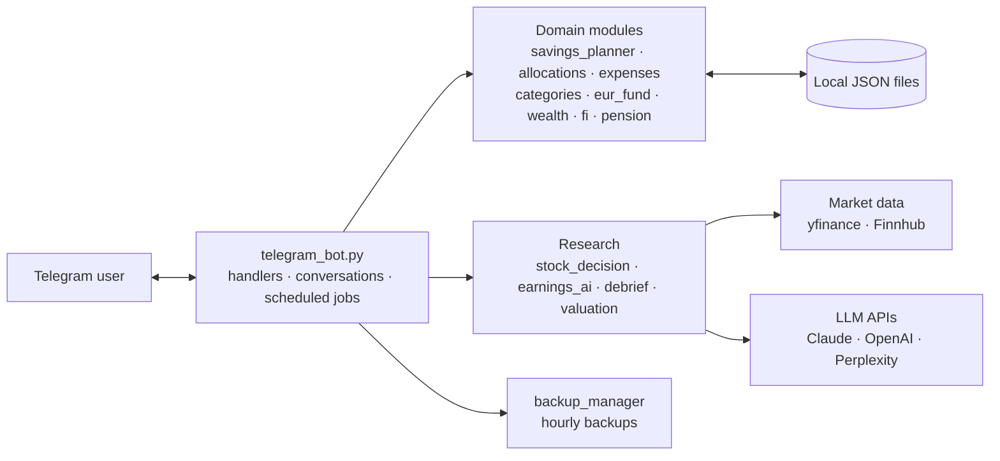

# Personal Finance & Stock Research Telegram Bot

[](https://github.com/Rian3693/personal-finance-telegram-bot/actions/workflows/tests.yml)


[](LICENSE)

A single-user Telegram bot, written in Python, that brings **stock-portfolio tracking and research** together
with **budgeting and savings planning**, built around Israeli personal finance (a shekel checking account, a
monthly credit-card charge, training and money-market funds). Everything happens in a chat: 100+ commands,
inline buttons and step-by-step conversations.

> **Not a trading system.** The bot records trades you enter yourself, tracks prices and produces research.
> It does not connect to a broker and never places orders. Its output is information for your own decisions,
> not investment advice.

---

## Highlights

- **12-month savings planner** — a conversational wizard that asks each month's expected income, previews
  where every shekel goes before saving, projects balances and goals month by month, and lets any single
  month be edited afterwards.
- **Spending tracker** — expenses by card with a model of the credit-card billing cycle, categories learned
  from the store name, monthly budgets, receipt-photo scanning and daily balance alerts.
- **Stock research** — portfolio P/L, background price and news alerts, valuation, rebalancing, and an
  earnings workflow that makes a prediction before the report and grades itself afterwards.
- **LLM integration done carefully** — Claude calls return **JSON-schema-structured output**; anything that
  becomes a number you act on (shares, tax, cash) is **computed in code, not by the model**; every paid call is
  **cost-logged**.
- **Tested domain logic** — the money calculations live in plain-Python modules with a pytest suite that runs
  on every push (GitHub Actions).

## Example output

Real output of the bot's `/payment` formatter, rendered with **synthetic data**
(more in [`docs/examples/`](docs/examples/)):

```text
💰 PAYMENT — January 2027
━━━━━━━━━━━━━━━━━━━━
Received: ₪9,000.00
💳 /ilcash now: ₪1,000.00

1. Top up /ilcash — ₪1,500.00
   ₪1,000.00 → brings it to ₪2,500.00

2. Split the remaining ₪7,500.00
   🛟 Emergency fund — ₪2,245.00  (30%)
   🎯 Future expenses — ₪1,500.00  (20%)
   💶 EUR savings — ₪750.00  (10%)
      → buy קרן כספית ליורו in shekels (≈ €187.50 at today’s rate)
   📈 USD stocks — ₪3,000.00  (40%)
      ≈ $810.81 at today’s rate

🏦 ILS bank transfer fee ₪5.00 already deducted above.
```

---

## Architecture



| Module | Responsibility |
|---|---|
| `telegram_bot.py` | Telegram layer: command and button handlers, `ConversationHandler` wizards, background loops, daily jobs |
| `savings_planner.py` | Payment breakdown, month-by-month projection, goal tracking, message formatting |
| `allocations.py` | Suggested vs. actually-moved allocation for each payment |
| `expenses.py`, `categories.py` | Spending ledger, credit-card cycle, categories / sub-categories, store memory, budgets |
| `receipts.py`, `earnings_ai.py`, `debrief.py` | Claude calls with JSON-schema output |
| `stock_decision.py` | `/shouldisell` pipeline; network legs are injectable, so it can be tested without API calls |
| `eur_fund.py`, `keren_self.py`, `ils_funds.py`, `wealth.py`, `fi.py`, `pension.py`, `taxyear.py` | Smaller money tools |
| `api_spend.py` | Cost log for paid API calls |
| `backup_manager.py` | Hourly and manual backups of the data files |
| `stock_agent.py`, `cli.py`, `collectors/`, `analyzers/` | An earlier command-line stock analyser (technical, fundamental, sentiment scoring) |

The domain modules are plain functions over dictionaries and do not import Telegram, which is what makes them
unit-testable.

## Tech stack

**Python 3.12** · **python-telegram-bot** (async) · **asyncio** · **yfinance** · **Finnhub API** ·
**Anthropic Claude API** · **OpenAI API** · **Perplexity API** · **pytest** · **GitHub Actions** ·
pandas / numpy / `ta` / rich (CLI analyser) · JSON file storage

---

## Getting started

```bash
python -m venv .venv
.venv\Scripts\activate          # Windows; on macOS/Linux: source .venv/bin/activate
pip install -r requirements.txt
copy .env.example .env          # macOS/Linux: cp .env.example .env — then fill it in
python telegram_bot.py
```

1. Create a bot with [@BotFather](https://t.me/BotFather) and put its token in `TELEGRAM_BOT_TOKEN`.
2. Put **your own** numeric Telegram user id in `TELEGRAM_CHAT_ID`. Only that user can use the bot, and
   scheduled messages are sent there.
3. AI and market-data keys are optional; commands that need a missing key will not work.

The command-line analyser runs separately: `python cli.py` or `python stock_agent.py AAPL`.

### Running the tests

```bash
pip install -r requirements-dev.txt
pytest
```

The tests cover the savings planner, payment breakdown and projection, allocation parsing, the euro fund,
financial-independence and pension maths, the tax-year summary, the credit-card cycle and category learning.
They need no network access and no API keys.

### Costs

Claude, OpenAI and Perplexity calls are billed by those providers per use; the bot logs an estimated cost for
paid AI calls (`api_spend.py`). Finnhub and Yahoo Finance are subject to the rate limits of your access plan.

---

## Privacy and security

- The bot stores personal financial data (balances, holdings, spending, receipts) in local JSON files and a
  `receipts/` folder. `.gitignore` excludes all of them, and **none are included in this repository**.
- Secrets live only in `.env` (excluded); `.env.example` contains placeholders.
- Access is limited to one Telegram user id.
- Receipt images and data sent for AI analysis are transmitted to the AI provider's API.

## Limitations

- Single user; local JSON storage rather than a database.
- `telegram_bot.py` is large (~37k lines); logic is being moved into separate, tested modules over time.
- Spending and balances are entered by hand or from receipts — there is no bank connection.
- The chat interface mixes Hebrew and English.

## About

A personal project, developed with AI-assisted tooling (Claude Code). Licensed under the [MIT License](LICENSE).
