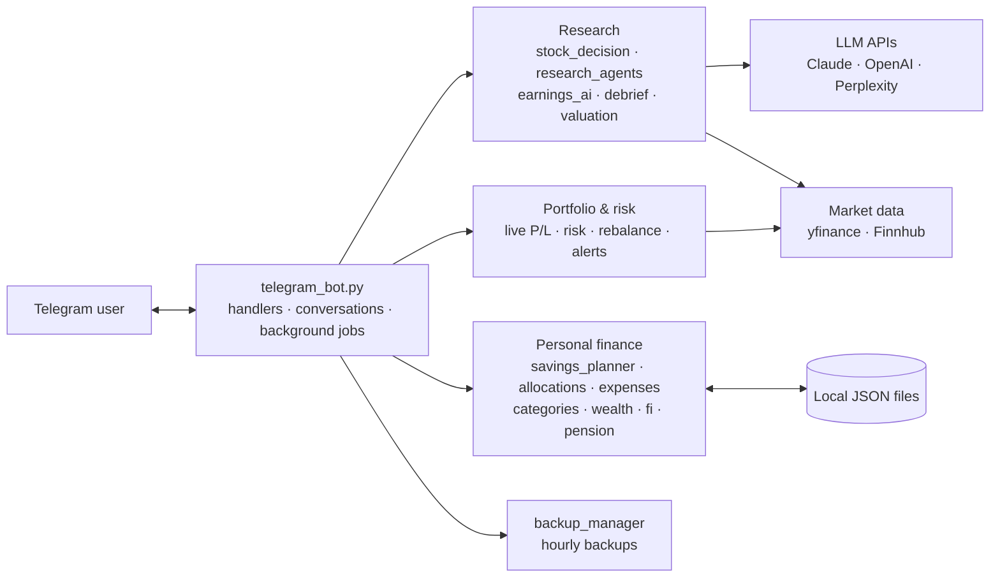

# Personal Finance & Stock Research Telegram Bot

[](https://github.com/Rian3693/personal-finance-telegram-bot/actions/workflows/tests.yml)


[](LICENSE)

A Telegram bot, written in Python, that acts as a personal **stock-research desk** and **money manager** in one
chat: live portfolio tracking, multi-agent AI research, risk analysis, earnings intelligence and price alerts,
alongside budgeting and a 12-month savings planner built around Israeli personal finance.
100+ commands, inline buttons and step-by-step conversations; background jobs send alerts and reports on
their own.

> **Not a trading system.** The bot records trades you enter yourself, tracks prices and produces research.
> It does not connect to a broker and never places orders. Its output is information for your own decisions,
> not investment advice.

---

## Highlights

### 🔬 AI stock research

- **`/shouldisell` — a research pipeline for one holding.** Collects position facts, price history,
  technicals, analyst targets and rating changes, insider activity, the earnings date, headlines and Zacks
  rating; runs **two independent Perplexity searches in parallel** (finance search and **Deep Research**); then
  Claude returns a **structured verdict** (sell / hold / add, reasons, price levels, hold-until horizon).
  Shares, tax and net cash are computed **in code, not by the model**, and the verdict's price levels become
  price alerts automatically. ([`stock_decision.py`](src/stock_decision.py))
- **`/research` — multi-agent deep research.** An orchestrator runs **8 specialist agents** — news analyst,
  earnings report, hype meter, technical insight, insider & institutional, peer comparison, macro & sector,
  and a FinRobot-style analyst — and merges them into one report. ([`research_agents/`](src/research_agents/))
- **Earnings intelligence.** Earnings-date reminders; an automatic report after each release with a
  **prediction made beforehand and graded afterwards**; `/predictions` keeps the track record and lessons;
  `/debrief` explains the latest report (what it said, sentiment, how it fits history, the options in numbers).
  ([`earnings_ai.py`](src/earnings_ai.py), [`debrief.py`](src/debrief.py))
- **`/valuation`** (cheap or expensive for the medium-long term, and why), **`/thesis`** (why each stock is
  held and what would break it), `/analyze`, `/entry`, `/news`, `/insiders`, `/zacks`.

### 📊 Portfolio and risk

- **`/portfolio`** — holdings with live prices and P/L; **`/today`** — today's P/L per stock (fast batch
  pricing), also sent automatically as a **daily report**; **`/total`** — every asset in shekels;
  `/heatmap` (green/red daily grid), `/weeklypl` (the week day by day, excluding that week's trades).
- **`/risk`** — portfolio volatility, **beta against the S&P 500**, historical **Value-at-Risk (95% / 99%)**
  and **stress-test scenarios**; `/correlation` and `/diversity` for concentration.
- **`/suggest`** — diversification ideas with dollar amounts to lower portfolio risk; **`/rebalance`** — the buys
  and sells to reach a target mix, in steps, with a tax estimate; `/vtiratio` — the path to a core-ETF ratio,
  with defensive-ETF mixes and how they behaved in the 2008 and 2022 drawdowns.
- Market context: `/macro` (yields, currencies, commodities), `/fear` (Fear & Greed), `/trending` (Reddit
  mentions), `/momentum`, `/backtest`, `/dca`, `/earnings`.

### 🔔 Alerts that run on their own

- **`/pricealert`** — price targets watched by a background loop, with a notification when crossed.
- A **news watch** on held stocks, P/L monitoring, earnings reminders, and daily spending and balance alerts.

### 💰 Personal finance

- **12-month savings planner (`/setplan`)** — a conversational wizard: each month's expected income, then a
  split between emergency fund, future expenses, euro savings and stocks, **previewed in shekels before it is
  saved**, projected month by month against goals, and editable one month at a time afterwards.
  `/payment` turns an arriving salary into transfers; `/allocated` records what was really moved.
- **Spending** — expenses by card with a model of the credit-card billing cycle, categories **learned from the
  store name**, monthly budgets, **receipt-photo scanning** (Claude), recurring subscriptions, an AI review of
  avoidable spending, and alerts as the account runs down.
- **Wealth tools** — net-worth snapshots, savings rate, emergency-fund runway, `/fi` (financial independence),
  `/pension`, `/taxyear`, `/whatif` (income-loss scenarios) and a monthly score.

### 🛠 Engineering

- **LLM integration done carefully** — Claude calls return **JSON-schema-structured output**; numbers you act on
  are computed in code; every paid call is **cost-logged** ([`api_spend.py`](src/api_spend.py)).
- **Async throughout** — python-telegram-bot's async API, background `asyncio` loops for alerts and monitors,
  blocking market-data calls moved off the event loop.
- **Tested domain logic** — the money calculations are plain-Python modules covered by a pytest suite that runs
  on every push (GitHub Actions). Hourly automatic backups of the data files.

## Example output

The bot's `/payment` formatter, rendered with **synthetic data** (more in [`docs/examples/`](docs/examples/)):

```text
PAYMENT — January 2027
Received: ₪9,000.00
Checking account now: ₪1,000.00

1. Top up the checking account — ₪1,500.00
   ₪1,000.00 → brings it to ₪2,500.00

2. Split the remaining ₪7,500.00
   Emergency fund   — ₪2,245.00  (30%)
   Future expenses  — ₪1,500.00  (20%)
   EUR savings      — ₪750.00    (10%)  → money-market fund in shekels (≈ €187.50)
   USD stocks       — ₪3,000.00  (40%)  ≈ $810.81 at today's rate

ILS bank transfer fee ₪5.00 already deducted above.
```

---

## Architecture



All code is in [`src/`](src/):

| Module | Responsibility |
|---|---|
| `telegram_bot.py` | Telegram layer: command and button handlers, `ConversationHandler` wizards, background loops, daily jobs, portfolio and risk commands |
| `stock_decision.py` | `/shouldisell` pipeline; every network leg is injectable, so it can be tested without API calls |
| `research_agents/` | `/research`: orchestrator + 8 specialist agents |
| `earnings_ai.py`, `debrief.py`, `valuation.py`, `thesis.py`, `rebalance.py`, `vti_ratio.py`, `weekly.py` | Earnings intelligence, valuation, thesis tracking, rebalancing, weekly P/L |
| `savings_planner.py`, `allocations.py` | Payment breakdown, month-by-month projection, goals; suggested vs. actual allocation |
| `expenses.py`, `categories.py`, `receipts.py`, `recurring.py`, `money_alerts.py` | Spending ledger, billing cycle, learned categories, receipt scanning, subscriptions, alerts |
| `wealth.py`, `fi.py`, `pension.py`, `taxyear.py`, `eur_fund.py`, `keren_self.py` | Smaller money tools |
| `api_spend.py`, `backup_manager.py` | API cost log; hourly and manual backups |
| `stock_agent.py`, `cli.py`, `collectors/`, `analyzers/` | An earlier command-line stock analyser (technical, fundamental and sentiment scoring) |

The domain modules are plain functions over dictionaries and do not import Telegram, which is what makes them
unit-testable.

## Tech stack

**Python 3.12** · **python-telegram-bot** (async) · **asyncio** · **yfinance** · **Finnhub API** ·
**Anthropic Claude API** · **Perplexity API** (incl. Deep Research) · **OpenAI API** · numpy / pandas ·
**pytest** · **GitHub Actions** · JSON file storage

---

## Getting started

```bash
python -m venv .venv
.venv\Scripts\activate          # Windows; on macOS/Linux: source .venv/bin/activate
pip install -r requirements.txt
copy .env.example .env          # macOS/Linux: cp .env.example .env — then fill it in
python src/telegram_bot.py
```

1. Create a bot with [@BotFather](https://t.me/BotFather) and put its token in `TELEGRAM_BOT_TOKEN`.
2. Put **your own** numeric Telegram user id in `TELEGRAM_CHAT_ID`. Only that user can use the bot, and
   scheduled messages are sent there.
3. AI and market-data keys are optional; commands that need a missing key will not work.

The command-line analyser runs separately: `python src/cli.py` or `python src/stock_agent.py AAPL`.

### Running the tests

```bash
pip install -r requirements-dev.txt
pytest
```

The tests cover the savings planner, payment breakdown and projection, allocation parsing, the euro fund,
financial-independence and pension maths, the tax-year summary, the credit-card cycle and category learning.
They need no network access and no API keys.

### Costs

Claude, Perplexity and OpenAI calls are billed by those providers per use; the bot logs an estimated cost for
paid AI calls. Finnhub and Yahoo Finance are subject to the rate limits of your access plan.

---

## Privacy and security

- The bot stores personal financial data (balances, holdings, spending, receipts) in local JSON files and a
  `receipts/` folder. `.gitignore` excludes all of them, and **none are included in this repository**.
- Secrets live only in `.env` (excluded); `.env.example` contains placeholders.
- Access is limited to one Telegram user id.
- Data sent for AI analysis (including receipt images) is transmitted to the AI provider's API.

## Limitations

- Single user; local JSON storage rather than a database.
- `telegram_bot.py` is large (~37k lines); logic is being moved into separate, tested modules over time.
- Spending and balances are entered by hand or from receipts — there is no bank connection.
- The chat interface mixes Hebrew and English.

## About

A personal project, developed with AI-assisted tooling (Claude Code). Licensed under the [MIT License](LICENSE).
